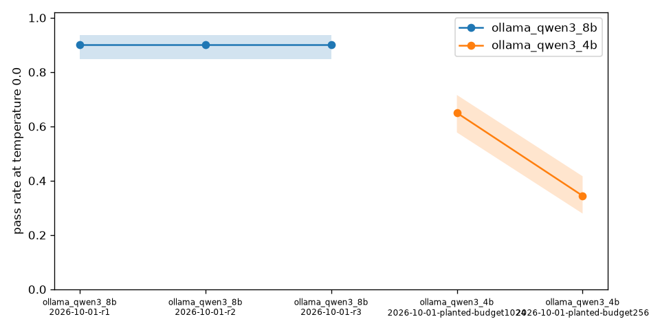
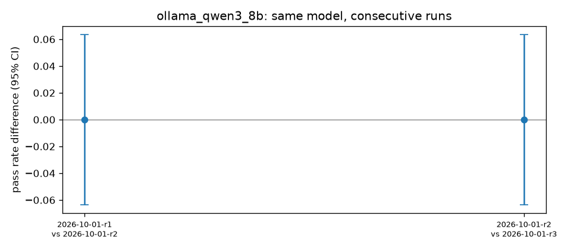
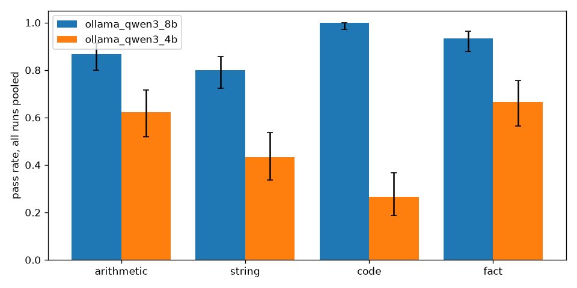

# model-nerf-watch

I wanted a cheap check I could run every day to see if a model is getting
worse, with confidence intervals and a noise floor I actually measured.

People keep saying the model they pay for got quietly worse. I saw a Hacker
News comment saying "it's so easy to check, but nobody ever proves it", so I
tried to check it properly on a laptop. I wrote 60 short probes whose answers
can be checked by code and sampled each one several times per run. Every pass
rate gets a Wilson interval, two runs get a paired test, and I worked out how
big a drop the setup can detect. The most useful thing I got out of it was the
noise floor, which I measured by running the same model against itself. All
the numbers below come from files in `results/`, and CI re-derives them with
`scripts/check_numbers.py`.

## Results



The model I watched is `qwen3:8b` on local Ollama (Q4_K_M, with thinking
turned off through `think: false`). I did three full runs on the same day. Each
probe was sampled 3 times at temperature 0 and 3 times at 0.7, which gives 180
samples per run for each temperature.

### Pass rate per run, temperature 0

| run | pass | n | rate | 95% Wilson CI |
|---|---|---|---|---|
| r1 | <!-- num:ollama_qwen3_8b.r1.k -->162 | <!-- num:ollama_qwen3_8b.r1.n -->180 | <!-- num:ollama_qwen3_8b.r1.rate -->0.900 | <!-- num:ollama_qwen3_8b.r1.lo -->0.847 to <!-- num:ollama_qwen3_8b.r1.hi -->0.936 |
| r2 | <!-- num:ollama_qwen3_8b.r2.k -->162 | <!-- num:ollama_qwen3_8b.r2.n -->180 | <!-- num:ollama_qwen3_8b.r2.rate -->0.900 | <!-- num:ollama_qwen3_8b.r2.lo -->0.847 to <!-- num:ollama_qwen3_8b.r2.hi -->0.936 |
| r3 | <!-- num:ollama_qwen3_8b.r3.k -->162 | <!-- num:ollama_qwen3_8b.r3.n -->180 | <!-- num:ollama_qwen3_8b.r3.rate -->0.900 | <!-- num:ollama_qwen3_8b.r3.lo -->0.847 to <!-- num:ollama_qwen3_8b.r3.hi -->0.936 |

At temperature 0.7 the three runs passed <!-- num:ollama_qwen3_8b.r1.t07.k -->162,
<!-- num:ollama_qwen3_8b.r2.t07.k -->162 and <!-- num:ollama_qwen3_8b.r3.t07.k -->161
of 180. Split by family for run 1 at temperature 0, it got arithmetic
<!-- num:ollama_qwen3_8b.r1.arithmetic -->39/45, string
<!-- num:ollama_qwen3_8b.r1.string -->36/45, code
<!-- num:ollama_qwen3_8b.r1.code -->45/45 and fact
<!-- num:ollama_qwen3_8b.r1.fact -->42/45. The same 6 probes fail in every
run. They are 47 * 83, 1001 mod 7, counting the r's in strawberry, two string
formatting tasks, and "Yen". On that last one the model says "Japanese Yen
(JPY)", so it's really my probe that's worded badly.



### The noise floor

Here I compare consecutive runs of the same model at temperature 0. The diff
column has a Newcombe 95% interval. I also ran a pooled two-proportion z-test,
and an exact McNemar test on the majority vote for each item.

| comparison | diff | 95% CI | z-test p | items pass to fail | fail to pass | McNemar p |
|---|---|---|---|---|---|---|
| r1 vs r2 | <!-- num:ollama_qwen3_8b.c1.diff -->+0.000 | <!-- num:ollama_qwen3_8b.c1.lo -->-0.064 to <!-- num:ollama_qwen3_8b.c1.hi -->+0.064 | <!-- num:ollama_qwen3_8b.c1.p_z -->1.00 | <!-- num:ollama_qwen3_8b.c1.b -->0 | <!-- num:ollama_qwen3_8b.c1.c -->0 | <!-- num:ollama_qwen3_8b.c1.p_mcnemar -->1.00 |
| r2 vs r3 | <!-- num:ollama_qwen3_8b.c2.diff -->+0.000 | <!-- num:ollama_qwen3_8b.c2.lo -->-0.064 to <!-- num:ollama_qwen3_8b.c2.hi -->+0.064 | <!-- num:ollama_qwen3_8b.c2.p_z -->1.00 | <!-- num:ollama_qwen3_8b.c2.b -->0 | <!-- num:ollama_qwen3_8b.c2.c -->0 | <!-- num:ollama_qwen3_8b.c2.p_mcnemar -->1.00 |



On local Ollama at temperature 0 with a fixed seed, the noise between runs
was basically zero. 178 of 180 outputs were byte identical across runs, and
the two that changed still got the same score. The interval is still 6.4
points wide, because 180 samples only gets you so far. I read that width as
the detection limit. The noise I actually saw was much smaller. A hosted API
won't give you a fixed seed, so I'd expect more noise there, somewhere inside
that interval.

### What the probe set can and cannot see

`nerfwatch power --baseline 0.9 --drop X` tells you how many items you need
per run to detect a drop of X at alpha 0.05 and power 0.8.

| drop | items per run needed |
|---|---|
| 5 points | <!-- num:power.drop5 -->686 |
| 10 points | <!-- num:power.drop10 -->199 |
| 20 points | <!-- num:power.drop20 -->62 |

I have 60 probes. If you pretend the 3 samples per probe are independent you
get 180 samples, which is enough for a 10 point drop but not a 5 point one.
They aren't really independent though. Counted as 60 correlated items, one run
can only reliably show a drop of about 20 points. To see smaller drifts you'd
need more probes, or several days of runs pooled together. This is the biggest
limitation of the whole thing.

### Planted degradation

I wanted to see the detector fire on a real change, so I ran `qwen3:4b`
through the same pipeline. It's the same family and quantisation with half the
parameters. Nobody changed qwen3:8b. It took two runs, and I learned something
from the first one by itself.

| run | pass | n | rate | 95% CI | vs qwen3:8b r3 | z-test p | McNemar p |
|---|---|---|---|---|---|---|---|
| 4b, 256 token budget | <!-- num:ollama_qwen3_4b.r2.k -->62 | 180 | <!-- num:ollama_qwen3_4b.r2.rate -->0.344 | <!-- num:ollama_qwen3_4b.r2.lo -->0.279 to <!-- num:ollama_qwen3_4b.r2.hi -->0.416 | <!-- num:cross2.diff -->-0.556 (<!-- num:cross2.lo -->-0.630 to <!-- num:cross2.hi -->-0.466) | <!-- num:cross2.p_z -->0.0e+00 | <!-- num:cross2.p_mcnemar -->1.0e-08 |
| 4b, 1024 token budget | <!-- num:ollama_qwen3_4b.r1.k -->117 | 180 | <!-- num:ollama_qwen3_4b.r1.rate -->0.650 | <!-- num:ollama_qwen3_4b.r1.lo -->0.578 to <!-- num:ollama_qwen3_4b.r1.hi -->0.716 | <!-- num:cross1.diff -->-0.250 (<!-- num:cross1.lo -->-0.331 to <!-- num:cross1.hi -->-0.166) | <!-- num:cross1.p_z -->1.3e-08 | <!-- num:cross1.p_mcnemar -->2.6e-03 |

The current `qwen3:4b` tag on Ollama ignores `think: false` and reasons in
plain text before it answers. With the same 256 token budget as the 8b model
it mostly never got to an answer. That looks like a huge nerf, and the canary
reports it like one. What actually changed was the output format, and the
model's ability had nothing to do with it. With a 1024 token budget it
finishes thinking on most probes and ends up 25 points below the 8b model. By
family at 1024 it got arithmetic
<!-- num:ollama_qwen3_4b.r1.arithmetic -->42/45, string
<!-- num:ollama_qwen3_4b.r1.string -->21/45, code
<!-- num:ollama_qwen3_4b.r1.code -->15/45 and fact
<!-- num:ollama_qwen3_4b.r1.fact -->39/45. Code is low because on those probes
the model often still runs out of tokens while it's reasoning. In the paired
test <!-- num:cross1.b -->17 items went from pass to fail and
<!-- num:cross1.c -->3 went the other way.



What I took from the planted run is that a canary easily catches "something
changed" when the change is big. To tell a real loss in ability apart from a
format or budget change, you have to look at the raw outputs. That's why I
store every one of them.

## How to run

```
python3 -m venv .venv && .venv/bin/pip install -r requirements.txt
.venv/bin/python -m nerfwatch run --model ollama/qwen3:8b --n 3
.venv/bin/python -m nerfwatch report
.venv/bin/python -m nerfwatch compare results/ollama_qwen3_8b/A.jsonl results/ollama_qwen3_8b/B.jsonl
.venv/bin/python -m nerfwatch power --baseline 0.9 --drop 0.1
```

`run` writes `results/<model>/<date>.jsonl` with one line per probe,
temperature and sample, including the raw output. If it stops halfway you can
rerun the same command and it skips what's already done. Use `--run-name` if
you want several runs on one day, and `--max-tokens` if the model thinks in
its output.

On qwen3 models you have to turn thinking off, otherwise the answer never
shows up inside a small budget. The Ollama adapter sends `think: false`. Some
models ignore it (the current `qwen3:4b` tag does), so in that case raise
`--max-tokens`. The scorer cuts everything up to the last `</think>`.

## Hosted models

Put the key in your environment and use the provider prefix.

| prefix | env var |
|---|---|
| `openai/gpt-4o-mini` | `OPENAI_API_KEY` |
| `groq/llama-3.1-8b-instant` | `GROQ_API_KEY` |
| `openrouter/meta-llama/llama-3.1-8b-instruct` | `OPENROUTER_API_KEY` |
| `anthropic/claude-3-5-haiku-latest` | `ANTHROPIC_API_KEY` |
| `gemini/gemini-2.0-flash` | `GEMINI_API_KEY` |
| `ollama/qwen3:8b` | `OLLAMA_HOST` (optional) |

The adapters just use `urllib`, I didn't pull in any SDKs. I've only actually
run Ollama so far. The other providers are tested against recorded responses
in `tests/fixtures/`. If you run a hosted model once a day with
`--run-name $(date +%F)`, `report` will draw the drift plot for you.

## Layout

- `nerfwatch/providers.py` request building and response parsing per provider
- `nerfwatch/probes.py` loading and scoring, no LLM judge
- `nerfwatch/stats.py` Wilson, Newcombe, two-proportion z, exact McNemar, power
- `nerfwatch/runner.py` resumable sampling loop
- `nerfwatch/report.py` tables, figures, `summary.json`
- `probes/*.jsonl` the 60 probes in 4 families
- `results/` every raw output and the derived figures
- `scripts/check_numbers.py` fails CI if the README disagrees with the data
- `notes/LOGBOOK.md` what was tried, including what went wrong
- `METHODOLOGY.md` the rules

`scripts/make_bars.py` redraws the bar chart at the top of the results section from `results/summary.json`, so the chart always matches the table.

## Limitations

- With 60 probes, one run can see a 20 point drop. It can't see a 5 point
  drift.
- So far every run happened on one day on one machine. The whole idea is to
  track drift over weeks, and I don't have that data yet.
- Exact string matching is strict. Some "failures" are just the model being a
  bit more helpful than I asked for. I count those as fails on purpose, since
  following instructions is part of what people complain about. It does mean
  the pass rate on its own shouldn't be read as a capability score.
- Code probes run the model's output in the same process with a 2 second
  alarm. Run it on a machine you don't mind the model touching.
- The planted drop comes from swapping in a different model. Nobody quietly
  changed anything. So it shows the detector fires, and says nothing about
  whether a provider has ever done this.

MIT licence.
